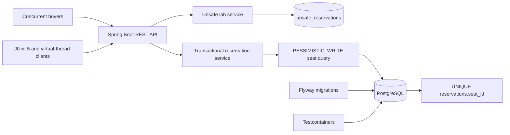

# Distributed Ticket Reservation API: PostgreSQL Correctness Core

A Java 25 and Spring Boot API that demonstrates why ticket correctness belongs in the authoritative database transaction.

## Invariant

For every seat ID, the `reservations` table contains at most one confirmed owner.

## Architecture



## Failure first

The unsafe endpoint performs an availability read, waits at a two-party barrier, and then inserts without a database lock or uniqueness constraint. The test intentionally proves two committed rows for one seat.

## Correctness path

1. Start a short transaction.
2. Lock the seat row with `PESSIMISTIC_WRITE`.
3. Reclaim an expired hold if necessary.
4. Validate the current state.
5. Create or confirm the hold.
6. Commit the seat state and reservation together.
7. Let `UNIQUE (seat_id)` provide a final database backstop.

## API

| Method | Path | Purpose |
| --- | --- | --- |
| GET | `/api/events/{eventId}/seats` | List logical seat availability |
| POST | `/api/events/{eventId}/holds` | Create a 30-second hold |
| POST | `/api/holds/{holdId}/confirm` | Confirm a live hold |
| DELETE | `/api/holds/{holdId}` | Release a live hold |
| GET | `/api/reservations/{reservationId}` | Retrieve a confirmed reservation |
| POST | `/api/lab/unsafe-reservations` | Reproduce double booking in the lab path |

## Run locally

```bash
docker compose up -d
mvn spring-boot:run
```

Seed event: `20000000-0000-0000-0000-000000000001`
Seed seat A1: `10000000-0000-0000-0000-000000000001`

## Run the proof

```bash
mvn test
```

| Scenario | Expected committed outcome |
| --- | --- |
| Unsafe two-buyer race | Two unsafe rows for one seat |
| Safe two-buyer hold race | One `201`, one `409`, one held owner |
| Duplicate confirmation | One reservation, one rejected retry |
| Expiry versus confirmation | Expired owner cannot confirm; next buyer can hold |

## Trade-offs

- Pessimistic locking is direct for a highly contended seat, but contenders wait and poor lock ordering can create deadlocks.
- Optimistic locking avoids waiting when conflicts are rare, but hot ticket drops can create failed work and retries.
- Lazy expiration keeps the hold decision inside the same seat transaction.
- The unsafe table exists only to preserve reproducible failure evidence.
- PostgreSQL requires retrying the complete transaction after serialization failures and deadlocks. Retry policy is deferred.

## Project 2 handoff

Project 2 adds PostgreSQL-backed idempotency, Redis admission control, two application instances, fail-open versus fail-closed outage behavior, and load testing. Redis reduces pressure but never authorizes a sale.

## Cleanup

```bash
docker compose stop
docker compose down -v
```