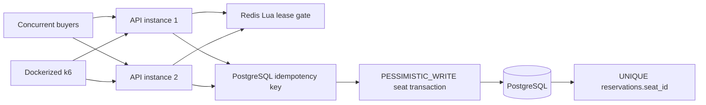

# Distributed Ticket Reservation API: Coordination Without Compromising Correctness

Two Spring Boot API instances share Redis admission state and a PostgreSQL booking database. Redis may shed load, but PostgreSQL remains the authority for idempotency and seat ownership.

## Architecture



## Correctness boundary

A Redis lease can expire while a slow request is still running, and fail-open can admit more work than the configured limit. Redis never authorizes a sale. PostgreSQL claims the idempotency key, locks the seat, writes the reservation, and enforces one reservation per seat in one transaction.

## Run

```bash
mvn test
mvn package
docker compose up -d --build
```

The instances listen on `http://localhost:8081` and `http://localhost:8082`.

## Failure modes

- `local`: one semaphore per JVM, so two instances can each admit a request.
- `redis`: one atomic shared lease set coordinates both instances.
- `fail-open`: bypass Redis after the 200 ms timeout and preserve booking availability.
- `fail-closed`: return `503` before opening a booking transaction.

## Load comparison

Run each case from a fresh database:

```bash
ADMISSION_MODE=off docker compose up -d --build
docker compose --profile load run --rm k6
docker compose down -v
ADMISSION_MODE=redis ADMISSION_LIMIT=8 ADMISSION_HOLD_DELAY=25ms docker compose up -d --build
docker compose --profile load run --rm k6
```

| Metric | Admission off | Redis admission |
| --- | ---: | ---: |
| Total HTTP requests | Record from `http_reqs` | Record from `http_reqs` |
| Requests per second | Record actual rate | Record actual rate |
| p50 latency | Record `med` | Record `med` |
| p95 latency | Record `p(95)` | Record `p(95)` |
| Completed reservations | Record counter and SQL | Record counter and SQL |
| Admission rejections | Record counter | Record counter |
| Retried requests | Record counter | Record counter |
| Idempotency replays | Record counter | Record counter |
| Idempotency conflicts | Record counter | Record counter |
| PostgreSQL deadlock or serialization conflicts | Record actual log count | Record actual log count |
| Duplicate confirmed seats | Must be `0` from SQL | Must be `0` from SQL |

Do not estimate missing values.

## Database assertions

```bash
docker compose exec -T postgres psql -U tickets -d tickets -c "SELECT COUNT(*) FROM reservations;"
docker compose exec -T postgres psql -U tickets -d tickets -c "SELECT seat_id, COUNT(*) FROM reservations GROUP BY seat_id HAVING COUNT(*) > 1;"
docker compose exec -T postgres psql -U tickets -d tickets -c "SELECT idempotency_key, COUNT(*) FROM idempotency_records GROUP BY idempotency_key HAVING COUNT(*) > 1;"
```

The last two queries must return no rows.

## Outage proof

Start a fresh fail-open stack and run `bash scripts/redis-outage-proof.sh`. The script reports request failures separately and exits nonzero only when a database invariant or Redis recovery check fails.

## Cleanup

```bash
docker compose stop
docker compose down -v
```